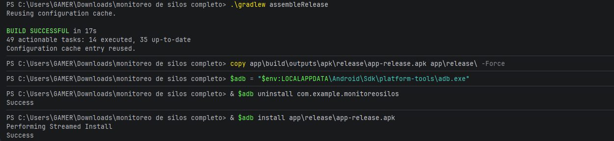
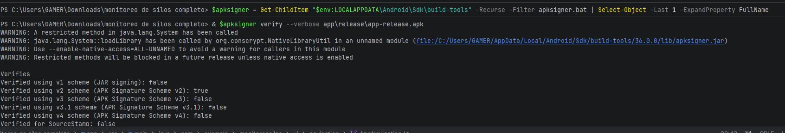
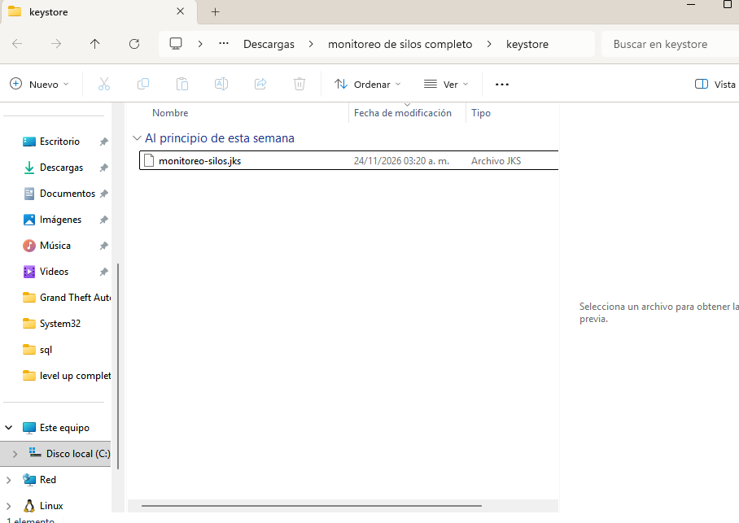
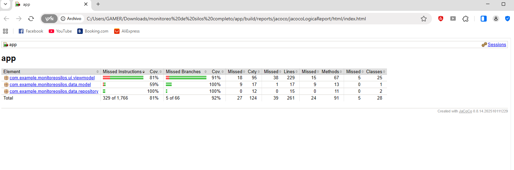

# Monitoreo de Silos

App móvil Android (Kotlin + Jetpack Compose) para monitorear el alimento de silos en granjas avícolas y ganaderas, con dos microservicios propios en Spring Boot. Proyecto de **DSY1105 Desarrollo de Aplicaciones Móviles** (Evaluación Parcial 4, Caso 3).

## 1. Integrantes
- Matias Ugalde — GitHub: `picasso1213`
- Matias Vega — GitHub: `MaTy294`

## 2. Funcionalidades
- Navegación con barra inferior y menú lateral; diseño adaptativo (Window Size Classes).
- Panel de silos con estado Normal / Advertencia / Crítico (umbrales del caso: >30 %, 20–30 %, <20 %) y días de alimento restantes.
- Formulario de registro con validaciones y resumen de datos.
- Persistencia local con Room y preferencias con DataStore; animaciones.
- Cámara y galería para evidencia fotográfica; notificaciones locales de silo crítico; detección de conectividad.
- **API externa (Retrofit):** pantalla *Avisos* con JSONPlaceholder, con estados de carga, error y reintento.
- **Microservicios propios (Retrofit):** pantalla *Servidor* con CRUD de silos e incidencias (crear, listar, editar, eliminar y resolver).
- Pruebas unitarias (JUnit, MockK, coroutines-test) y APK firmado.

## 3. Arquitectura
MVVM: `ui/screen` (Compose) → `ui/viewmodel` → `data/repository` → `data/remote` (Retrofit) y `data/local` (Room).

```
MonitoreoSilos/
├── app/                      # App Android
├── microservicios/
│   ├── ms-silos/             # Spring Boot, puerto 8081, BD H2
│   └── ms-incidencias/       # Spring Boot, puerto 8082, BD H2
└── keystore/monitoreo-silos.jks
```

## 4. Endpoints

### API externa (JSONPlaceholder)
| Método | URL |
|---|---|
| GET | `https://jsonplaceholder.typicode.com/posts` |
| GET | `https://jsonplaceholder.typicode.com/posts/{id}` |

### ms-silos — `http://localhost:8081`
| Método | Ruta | Descripción |
|---|---|---|
| GET | `/api/silos` | Lista los silos |
| GET | `/api/silos/{id}` | Obtiene un silo |
| GET | `/api/silos/alertas` | Silos con nivel ≤ 30 % |
| POST | `/api/silos` | Crea un silo |
| PUT | `/api/silos/{id}` | Actualiza un silo |
| DELETE | `/api/silos/{id}` | Elimina un silo |

### ms-incidencias — `http://localhost:8082`
| Método | Ruta | Descripción |
|---|---|---|
| GET | `/api/incidencias` | Lista (filtro opcional `?siloId=`) |
| GET | `/api/incidencias/{id}` | Obtiene una incidencia |
| POST | `/api/incidencias` | Crea una incidencia (estado ABIERTA) |
| PUT | `/api/incidencias/{id}` | Actualiza una incidencia |
| PATCH | `/api/incidencias/{id}/resolver` | Marca como RESUELTA |
| DELETE | `/api/incidencias/{id}` | Elimina una incidencia |

Ejemplo de cuerpo para `POST /api/silos`:
```json
{"granja":"Granja Los Aromos","nombre":"Silo A5","capacidadKg":20000,"nivelKg":15000,"tipoAlimento":"Engorda","consumoDiarioKg":1200}
```

## 5. Pasos para ejecutar
Requisitos: JDK 17 o superior, Maven y Android Studio.

1. **Microservicios** (una terminal por servicio):
   ```
   cd microservicios/ms-silos
   mvn spring-boot:run
   ```
   ```
   cd microservicios/ms-incidencias
   mvn spring-boot:run
   ```
   Cada servicio debe mostrar `Started ... Application`. Para comprobarlo, abrir `http://localhost:8081/api/silos`.
   Consola de la BD: `http://localhost:8081/h2-console` (JDBC `jdbc:h2:file:./data/ms-silos`, usuario `sa`, sin clave).
2. **App:** abrir la carpeta raíz en Android Studio, sincronizar Gradle y ejecutar en un emulador (usa `10.0.2.2` para llegar al PC). En un celular físico, cambiar `HOST` en `app/src/main/java/com/example/monitoreosilos/data/remote/BackendClient.kt` por la IP del PC en la misma red WiFi.
3. **Pruebas unitarias:** `./gradlew testDebugUnitTest`
   **Cobertura:** `./gradlew createDebugUnitTestCoverageReport` (informe en `app/build/reports/coverage/`).
4. **APK firmado:** `./gradlew assembleRelease`. El APK queda en `app/build/outputs/apk/release/`.

## 6. Captura del APK firmado y .jks

**APK firmado** (`app/release/app-release.apk`), verificado con `apksigner`:




**Llave generada** (`keystore/monitoreo-silos.jks`, alias `monitoreosilos`):



La configuración de firma está en `app/build.gradle.kts`, bloque `signingConfigs`.

## Cobertura de pruebas



## Planificación y trabajo en equipo
- Trello: [pegar enlace del tablero]
- Ramas por funcionalidad en GitHub y commits de ambos integrantes.